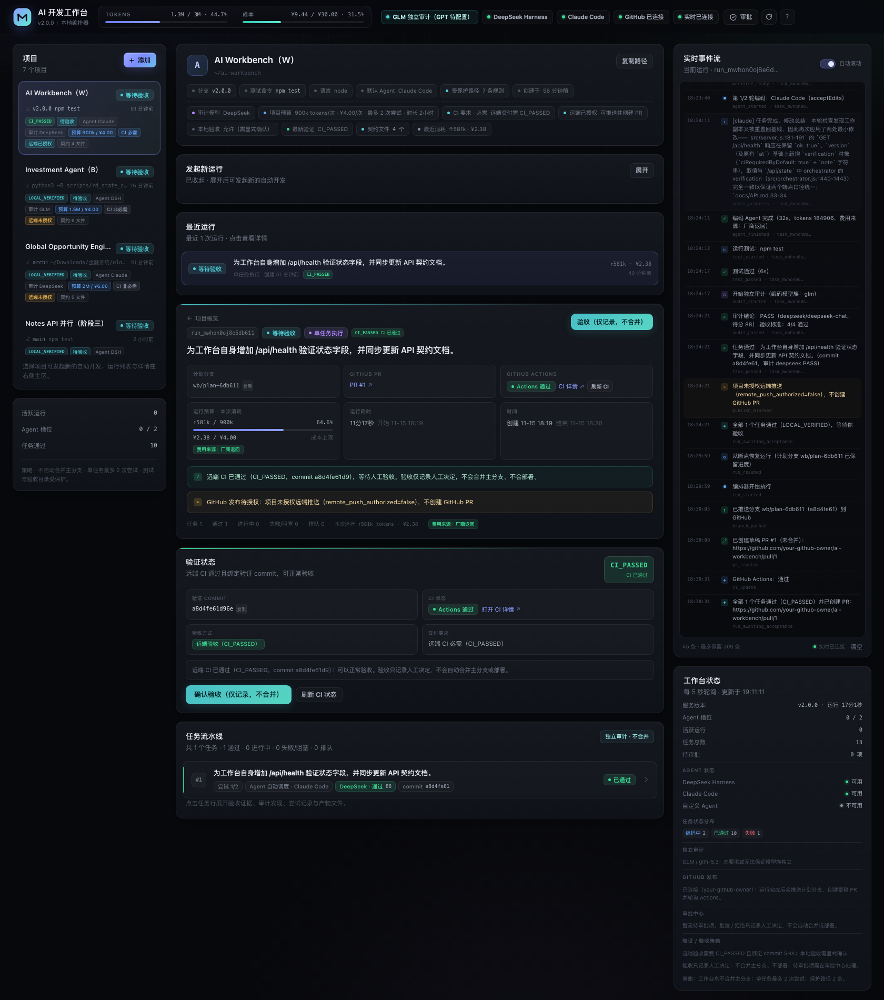

# AI 开发工作台（AI Development Workbench）v2.0

**只管给需求，开发、测试、独立审计、自动修复、跨 Agent 推进，最后给你验收。**

一套可实际运行的 AI 全自动软件开发工作台：添加 GitHub 项目或本地仓库，输入产品目标与验收标准，系统自动完成
任务规划 → 编码 → 测试 → 独立模型审计 → 失败修复 → 逐任务推进 → 推送分支 / 创建草稿 PR / 运行 GitHub Actions，
整个过程可暂停、可中断、可恢复，并实时显示在 Web 界面中。**工作台永不合并主分支，合并由你人工决定。**



---

## 0. v2.0 新增（安全与多项目接入）

- **P0 安全整改**：Claude 默认受限（acceptEdits+工具白名单，不再 bypass）、测试/Agent 最小环境变量、API Token/Cookie 认证与 CSRF/Host 校验、测试命令 allowlist、产物路径/symlink 防护。
- **独立审计加固**：验收标准逐条精确匹配+证据硬校验、PASS/FAIL/UNKNOWN 三态、diff 分块审计、测试/审计/提交 SHA 指纹绑定、审计模型与编码模型族独立选择。
- **CI 交付闸门**：LOCAL_VERIFIED / CI_PENDING / CI_PASSED / CI_FAILED；验收必须绑定真实 commit；CI 未过不会进入待验收。
- **预算与失败控制**：全局/项目/运行/任务预算、墙钟、运行锁、重复失败检测、费用来源（厂商返回/估算/UNKNOWN，不以 0 冒充）。
- **审批中心**：CI 闸门、远端推送等需要人工决定的事项集中展示；批准不合并、不部署。
- **自我升级**：独立候选副本 → 离线测试 → 隔离实例冒烟 → （可选）真实任务验证 → 才允许升级 PR；稳定实例不受影响。
- **多项目接入**：W（自身）/ A（Global Opportunity Engine，只读+沙箱分支）/ B（Investment Agent，READ_ONLY，权威树禁止写入）。
- 详细 v2 报告：[docs/v2/PHASE0-AUDIT.md](docs/v2/PHASE0-AUDIT.md)、[P0 审计](docs/v2/P0-AUDIT.md)、[安全整改](docs/v2/SECURITY-REMEDIATION.md)、[验收矩阵](docs/v2/ACCEPTANCE-MATRIX.md)、[自我升级](docs/v2/UPGRADE.md)。

## 0.1 v2.1 新增（持续自主研发）

- **持续自主研发循环**：Planner 识别真实缺口 → 单任务开发/测试/独立审计/修复 → 内部验收 → 更新项目基线 → 自动下一轮；无任务/失败/授权阻塞时停止，不制造任务。W 已连续完成 3 轮真实任务（API/UI/CLI），支持中断恢复。
- **GLM 预算授权**：GLM 真实 token/cache/费用完整记录且不受工作台内部预算上限；DeepSeek/OpenAI 仍受原预算；API/UI 按 provider 分开统计。
- **执行隔离**：Docker/sandbox 能力实际探测；本机不可用时使用受限独立运行环境并将内核级隔离标记 BLOCKED，要求强隔离的项目 fail-closed。
- 报告：[v2.1 工程报告](docs/v2.1/REPORT.md)、[v2.1 验收矩阵](docs/v2.1/ACCEPTANCE-MATRIX.md)、[隔离](docs/v2.1/ISOLATION.md)。

## 0.2 v2.2 新增（自主研发可靠性收口）

- **真正容器执行隔离**：Docker 适配器 + 运行时镜像；minimal worktree mount、cap-drop、no-new-privileges、只读 rootfs、network none(测试)、非 root、pids/memory/cpu 限制、超时清理；Docker 不可用 fail-closed。真实容器内 Claude Agent + 容器测试 E2E PASS。
- **GLM 预算按实际模型身份**：只有 known GLM 豁免；Claude Code 使用 OpenAI/Anthropic/DeepSeek 端点不豁免；unknown 永不豁免；DeepSeek/OpenAI 原预算不变；四类供应商回归测试。
- **持续研发可靠性**：3 个真实任务、SIGKILL 中断恢复、循环完成判定、幂等/不重复 commit、Git 基线校验、UNKNOWN 不推进、无任务/阻塞正确停止。
- 报告：[v2.2 报告](docs/v2.2/REPORT.md)、[验收矩阵](docs/v2.2/ACCEPTANCE-MATRIX.md)、[容器隔离](docs/v2.2/CONTAINER-ISOLATION.md)、[GLM 身份](docs/v2.2/GLM-IDENTITY.md)。

## 0.3 v2.3 新增（无人监督自主执行可靠性）

- **真实进度看门狗**：按 worktree 实际推进检测 Agent 无进展，超时终止并保留证据；支持新会话重试与备选 Agent 切换（非 GLM 备选受预算约束）。
- **失败分类与恢复**：stalled/timeout/budget/no-output/agent/infrastructure 分类持久化；主 Agent 失败→备选→主 Agent 全新会话；无人工代码干预。
- **关键可靠性根因修复**：任务 `verification_json` 指数膨胀（Invalid string length）、低预算 finalize 阻塞、GLM 身份/预算、容器执行保持。
- 验收：5 个冻结任务 5/5 自主完成、10/10 测试、5/5 独立审计、2/2 故障恢复；**严格 24h 窗口未执行，24h 验收 FAIL/UNKNOWN**。详见 [v2.3 报告](docs/v2.3/REPORT.md)、[验收矩阵](docs/v2.3/ACCEPTANCE-MATRIX.md)。

## 0.5 v2.5 新增（真实产品交付）

- **Consumption Decision Lab** 真实 Web 产品：Claude Code/GLM 编码，冻结测试/build/真实浏览器验收，DSH 只读独立审计 PASS 100；详见 [v2.5 报告](docs/v2.5/REPORT.md) 与产品源码 `projects/consumption-decision-lab`（release/v0.1.0）。
- **DSH 审计适配器**：真实 CLI、只读独立工作区、预审计 commit 绑定、逐条证据；项目级 ¥30 审计预算独立核算。
- 已知未完成：Fencing Token、24h 连续验收；不标 PASS。

## 0.4 v2.4 新增（长时间无人监督运行）

- **独立 Supervisor**：launchd/systemd + 守护脚本；进程退出/健康无响应检测、指数退避/熔断、崩溃记录、健康恢复后自动对账/续跑受管任务。
- **Durable Orchestrator**：SQLite 项目写租约/run 租约、单写所有权、恢复前 DB/Git/审计对账、幂等恢复与检查点。
- **Agent 自主恢复**：事件+worktree 双通道无进展检测、失败分类、备选 Agent 过滤与主 Agent 新会话重试。
- **Provider-aware 审计资源调度**：审计 Provider 独立选择；审计资源不可用时在编码前安全阻塞并保存检查点；GLM 授权豁免，非 GLM 预算不放宽。
- **验收状态**：`24H_AUTONOMY_NOT_VERIFIED`（24h 未执行；独立审计预算不足），v2.3 加速无人监督验收 5/5 自主通过。详见 [v2.4 报告](docs/v2.4/REPORT.md)、[验收矩阵](docs/v2.4/ACCEPTANCE-MATRIX.md)、[Supervisor](supervisor/README.md)。

## 1. 核心能力

| 能力 | 实现 |
|---|---|
| 多项目管理 | SQLite 持久化项目、计划、运行、任务、尝试、审计、事件 |
| 统一编排器 | 确定性任务状态机 + 每任务独立 Git worktree/branch + CAS 状态迁移 |
| 多 Coding Agent | **DeepSeek Harness headless**、**Claude Code**，以及可配置的通用命令式 Agent（预留接口） |
| 多任务规划 | DeepSeek 规划器读取仓库上下文（README/TASKS.md/文件树）生成带可验证验收标准的任务计划 |
| 独立审计 | **GPT API 优先**（`OPENAI_API_KEY`）、未配置时降级 **GLM-5.3**；逐条核对验收标准，代码做硬校验，模型不能自封通过 |
| 自动修复循环 | 测试失败 / 审计失败 → 把失败原因回灌同一 Agent 会话 → 重测 → 复审，尝试次数受控 |
| 质量门禁 | 测试目录、验收文件受保护（Agent 篡改会被还原并记录违规）；测试必须真实运行并通过 |
| 预算控制 | 全局 token / 成本上限、单任务上限、每次调用前校验、超限自动暂停并展示用量 |
| 权限边界 | 只创建分支与草稿 PR，**永不合并**；不碰生产环境；不自动付款；GitHub Token 未配置时远端动作记为"待授权"而非伪造 |
| 断点恢复 | 进程崩溃/重启后自动识别中断运行，保留计划分支与已完成任务，从断点继续 |
| 实时可视化 | Web 工作台：项目 / 任务流水线 / Agent / 实时事件 / 独立审计结论 / 成本 / PR / CI |

## 2. 快速开始

**环境要求**：macOS / Linux（Windows 未验证），Node.js ≥ 24，Git；本机已安装并登录 DSH 或 Claude Code 之一（至少一个 Coding Agent 可用）。

```bash
git clone https://github.com/bojing951-hash/ai-workbench.git
cd ai-workbench
cp .env.example .env      # 填写模型 Key（见第 3 节）
npm start                 # 启动工作台（默认 http://127.0.0.1:4477）
```

打开浏览器访问 **http://127.0.0.1:4477**，即可：

1. **添加项目**：GitHub 仓库地址 / `owner/repo` / 本地已有目录；
2. **输入目标与验收标准**：可单任务执行，也可让规划器自动拆成多任务；
3. **启动自动开发**：实时看编码、测试、审计、修复与成本；
4. **查看进度**：任务流水线、每次尝试的 diff/测试日志/审计报告、PR 与 CI 状态；
5. **最终验收**：点击「验收」只记录你的验收结论，不会合并主分支。

> 详细操作见 [docs/USAGE.md](docs/USAGE.md)，配置项见 [docs/CONFIG.md](docs/CONFIG.md)，架构见 [docs/ARCHITECTURE.md](docs/ARCHITECTURE.md)。

## 3. 配置（`/.env`，已被 gitignore）

```ini
# 独立审计（首选 GPT；未配置自动降级 GLM-5.3）
OPENAI_API_KEY=
OPENAI_BASE_URL=https://api.openai.com/v1
OPENAI_AUDIT_MODEL=gpt-4.1
GLM_API_KEY=
GLM_BASE_URL=https://open.bigmodel.cn/api/anthropic
GLM_AUDIT_MODEL=glm-5.3

# 规划器（DeepSeek OpenAI 兼容接口）
DEEPSEEK_API_KEY=
PLANNER_MODEL=deepseek-chat

# Coding Agent
DSH_BIN=/Applications/DeepSeek Harness.app/Contents/Resources/runtime/cli/bin/dsh
DSH_PERMISSION_MODE=workspace-write   # 嵌套沙箱环境用 danger-full-access
CLAUDE_BIN=claude

# GitHub（阶段三：分支/PR/Actions）
GITHUB_TOKEN=
GITHUB_OWNER=

# 预算与策略
MAX_TOTAL_TOKENS=3000000
MAX_COST_CNY=30
MAX_ATTEMPTS=2
```

说明：

- **Agent 认证**：DSH headless 读取 `DEEPSEEK_API_KEY`；Claude Code 默认继承本机配置（若使用 GLM 端点，可设置 `CLAUDE_BASE_URL/CLAUDE_API_KEY/CLAUDE_MODEL`）。工作台给 Claude Code 使用**隔离的配置目录**，不会改动你的 `~/.claude`。
- **GPT 审计**：填入 `OPENAI_API_KEY` 后审计自动切到 GPT；界面会实时显示当前审计提供方。
- 密钥只存在于 `.env` 与环境变量中，不写入数据库/事件/日志（日志统一脱敏）。

## 4. 三阶段真实验收

| 阶段 | 真实验收内容 | 结果 | 证据 |
|---|---|---|---|
| 阶段一 | 单项目自动开发 → 测试 → 独立审计 → **审计失败自动修复** → 通过 | 第 1 次审计 fail(75) → Agent 修复 → 第 2 次审计 pass(96)，6/6 验收标准通过 | `demo/evidence/phase1-*.json` |
| 阶段二 | 多任务自动规划 → 逐任务自动推进 → **SIGKILL 进程中断 → 重启 → 断点恢复** | 规划 3 任务；任务 2 编码中被杀；重启后恢复并全部通过 | `demo/evidence/phase2-*.json` |
| 阶段三 | 两项目并行 → 任务级跨 Agent（DSH + Claude Code）→ 推送分支 / 草稿 PR / GitHub Actions | 2 项目并行完成；草稿 PR #1 已创建且 **CI success**；未合并 | `demo/evidence/phase3-*.json` |

三阶段真实验收共消耗 **1,096,639 tokens / ¥1.69**（在 3M tokens、¥30 预算内）。完整数据、缺陷修复记录与限制说明见 [docs/TEST-REPORT.md](docs/TEST-REPORT.md)。

阶段三真实 PR：<（私有演示仓库 PR #1，链接已脱敏）>（draft、open、未合并）；GitHub Actions：<（私有演示仓库 Actions 运行，链接已脱敏）>（success）。

复现方式（需要真实模型调用预算）：

```bash
npm start                     # 终端 A
npm run demo:phase1           # 终端 B：阶段一
# 阶段二会重启服务，需先停止终端 A 的工作台，再执行：
npm run demo:phase2
npm start                     # 阶段二结束后重新启动
npm run demo:phase3           # 阶段三（GitHub 部分需要 GITHUB_TOKEN）
```

真实验收使用仓库中**预置的、未修改的验收测试**（`demo/*/tests`），并启用 protected paths：Agent 试图修改测试会被还原并使该次尝试失败，防止"改测试即通过"。

## 5. 架构一览

```
                        ┌────────────────────────────┐
  浏览器  ◀──SSE/JSON──▶│  Web 工作台（零依赖 SPA）     │
                        └─────────────┬──────────────┘
                                      │ HTTP API
                        ┌─────────────▼──────────────┐
                        │  统一编排器 Orchestrator      │
                        │  确定性状态机 / 预算 / 策略    │
                        └──┬────────┬────────┬────────┘
              ┌────────────▼─┐  ┌───▼────┐  ┌▼──────────────┐
              │ 规划器        │  │ 测试   │  │ 独立审计器      │
              │ DeepSeek LLM │  │ runner │  │ GPT / GLM      │
              └──────────────┘  └───┬────┘  └───────┬────────┘
                                    │               │ 失败修复反馈
                        ┌───────────▼───────────────▼────────┐
                        │ Coding Agent 适配层                  │
                        │ DSH headless │ Claude Code │ Custom │
                        └──────────────────┬─────────────────┘
                                           │ 每任务独立 worktree/branch
                        ┌──────────────────▼─────────────────┐
                        │ Git / GitHub（分支、草稿 PR、CI）     │
                        └────────────────────────────────────┘
```

- **状态机**：`queued → preparing → coding → testing → auditing → committing → passed`，测试/审计失败进入 `repairing` 后重试；超过上限 → `failed`（记录阻塞原因，绝不伪造通过）。
- **运行状态**：`queued → running → awaiting_acceptance → accepted`，支持 `paused / interrupted / cancelled` 与恢复。
- **持久化**：SQLite（`data/workbench.db`）+ `data/artifacts/`（提示词、diff、测试日志、审计 JSON）+ 每任务 Git 分支 = 可审计、可恢复。
- **并发**：同一计划内严格顺序（后任务依赖前任务代码）；不同项目可并行，全局 Agent 并发信号量控制。

## 6. 目录结构

```
bin/workbench.js          CLI：serve / run / status / resume / accept
src/orchestrator.js       统一编排器（状态机、修复循环、发布、恢复）
src/db.js                 SQLite 持久化
src/agents/               Coding Agent 适配器（dsh / claude / custom）
src/auditors/             独立审计器（GPT / GLM，硬校验结论）
src/planner.js            LLM 多任务规划器
src/llm.js                统一 LLM 客户端（OpenAI / Anthropic 兼容）
src/git.js / src/github.js Git 工作流与 GitHub PR/Actions
src/policy.js             预算、保护路径、审计结论硬校验
web/                      可视化工作台（纯原生，无需构建）
demo/                     三阶段真实验收项目与证据
tests/                    单元 + 集成测试（离线、零模型调用）
docs/                     使用说明 / 架构 / 配置 / 测试报告
```

## 7. 测试

```bash
npm test          # 180 个用例全部通过；零依赖、离线、无需 API Key、不消耗 token
```

工作台的 GitHub Actions 配置见 [.github/workflows/ci.yml](.github/workflows/ci.yml)，每个 demo 项目也内置 CI 工作流（阶段三 PR 会真实触发）。

## 8. 安全与边界

- 工作台只监听 `127.0.0.1`，无对外暴露；密钥不进入前端与日志。
- **永不合并主分支**：只更新 `wb/plan-*` 计划分支、推送、创建草稿 PR；合并必须由人工在 GitHub 完成。
- **不伪造结果**：测试未执行/未通过不会进入审计；审计必须返回合法结构且全部验收标准 pass 才可提交；审计模型不可用时任务阻塞而不是放行。
- **保护验收标准**：`tests/**`、`acceptance/**`、`package.json` 等可配置为 protected paths，Agent 修改会被还原并记录违规事件。
- **预算硬上限**：每次 Agent/审计调用前校验，超限自动暂停；界面与 API 实时展示用量。
- 若缺少授权（如 GitHub Token），对应动作记为 **blocked/待授权** 并继续其他独立任务，不虚构成功。

## 9. 开源、许可证与归属

- 许可证：**Apache-2.0**（见 [LICENSE](LICENSE) 与 [NOTICE](NOTICE)），可自由使用、修改、商用；
  分发时需保留版权、许可声明与 NOTICE，并附带明确的专利授权；许可证不授予商标使用权。
- 作者/维护者：[@bojing951-hash](https://github.com/bojing951-hash)。
- 项目名与品牌：「AI 全自动工作台」。如需商业使用项目名/Logo 做官方宣传，请先联系维护者获得许可。
- 贡献指南：[CONTRIBUTING.md](CONTRIBUTING.md)；安全问题报告：[SECURITY.md](SECURITY.md)。
- 发布到 GitHub 前的检查清单（密钥扫描、截图脱敏、仓库设置、非官方声明）：[docs/PUBLISHING.md](docs/PUBLISHING.md)。
- 本项目是独立第三方工具，与 DeepSeek、Anthropic 等厂商**无隶属或官方授权关系**；"DeepSeek Harness""Claude Code"
  等名称归各自厂商所有。
- 适合：希望把"需求 → 实现 → 测试 → 独立审计 → 修复 → PR"自动化的个人开发者/小团队，且能接受早期版本与
  真实模型成本。不适合：多租户 SaaS、生产环境无人值守变更、对 Agent 命令执行零风险的场景。

## 10. 已知限制

- GPT 审计适配器已实现，但本机未配置 `OPENAI_API_KEY`，因此真实演示使用 GLM-5.3 做独立审计（界面/报告均如实标注）；填入 Key 后自动切换 GPT。
- 演示仓库 main 基线（占位实现）的 CI 是失败的，PR 分支 CI success 才是验收信号（详见测试报告）。
- GitHub Actions 结果轮询有超时上限，超时后可在界面手动刷新。
- 同一计划内任务顺序执行（保证依赖正确），跨项目并行；任务级 DAG 依赖将在后续版本扩展。
- 工作台通过本机 CLI 调用 Agent，要求本机已安装并认证对应 Agent。
