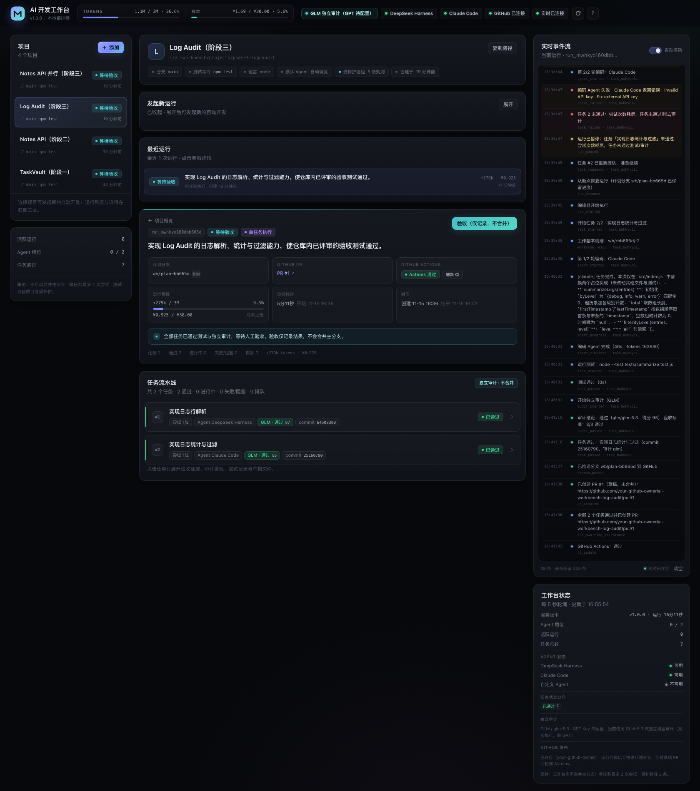
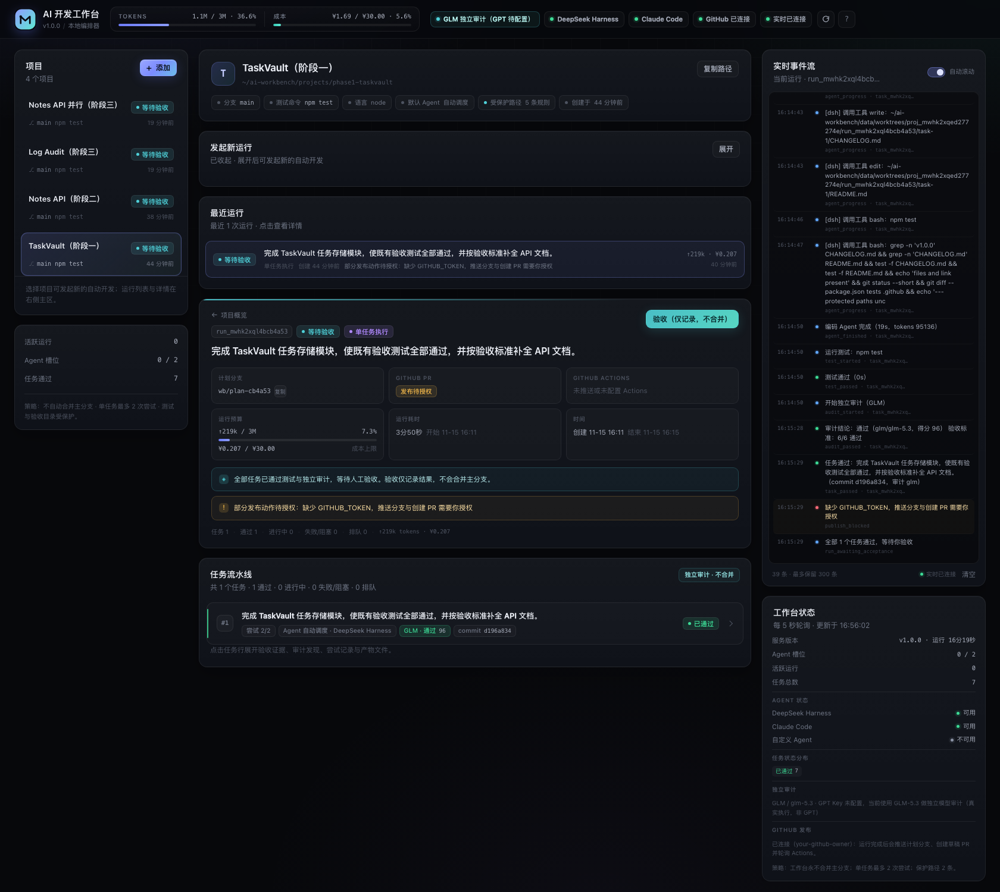

# 端到端演示

本演示全部为真实执行：真实 Coding Agent（DeepSeek Harness headless / Claude Code）、真实测试命令、真实独立模型审计、真实 Git 与 GitHub 操作。证据文件在 `demo/evidence/`。

## 场景总览

| 阶段 | 演示项目 | 关键验证 |
|---|---|---|
| 一 | TaskVault（任务存储库） | 自动开发 → 测试通过 → 独立审计失败 → 自动反馈修复 → 复审通过 |
| 二 | Notes API（3 个依赖任务） | LLM 自动规划 3 任务 → 逐任务推进 → 进程 SIGKILL → 重启 → 断点恢复完成 |
| 三 | Log Audit + Notes 并行项目 | 两项目并行 → 任务级跨 Agent（DSH / Claude Code）→ 真实 GitHub 仓库/分支/草稿 PR/Actions |

## 阶段一：单项目闭环（含审计失败自动修复）

```bash
npm start
npm run demo:phase1
```

真实步骤（可在界面与事件流中逐步查看）：

1. 工作台克隆/登记演示项目，创建计划分支 `wb/plan-*` 与任务 worktree；
2. DSH Coding Agent 在隔离工作副本中读取验收测试并实现 `src/store.js` 与 README `## API`；
3. 工作台执行真实测试 `npm test`（6/6 通过）；
4. 独立审计（GLM-5.3）逐条核对验收标准，发现缺少隐藏验收要求的 `CHANGELOG.md` 与 README 链接 → **verdict=fail (75)**；
5. 工作台把审计 `required_fixes` 反馈给同一 DSH 会话，Agent 修复并重新自测；
6. 再次执行测试与独立审计 → **verdict=pass (96)**，工作台提交任务并推进计划分支；
7. 运行进入 `awaiting_acceptance`，等待人工验收（未合并主分支）。

真实结果：第 1 次审计 fail(75) → 修复 → 第 2 次审计 pass(96)；commit `d196a834…`；219,045 tokens / ¥0.2067。
证据：[`demo/evidence/phase1-*.json`](../demo/evidence/)（包含两次审计的逐条标准、失败原因、token/成本）。

## 阶段二：多任务规划 + 进程崩溃恢复

```bash
# 先停止 npm start 的服务（脚本需要自己重启进程）
npm run demo:phase2
```

真实步骤：

1. 规划器调用 DeepSeek，读取仓库 README/TASKS.md/文件树，自动生成 3 个有序任务（含各自测试命令与验收标准）；
2. 逐任务执行：任务 1 编码→测试→审计→通过→提交→自动进入任务 2；
3. 任务 2 编码过程中，脚本对工作台进程发送 **SIGKILL**；
4. 重启工作台：启动恢复逻辑把运行标记为 `interrupted`，已通过任务与计划分支保留；
5. 调用恢复接口：中间态任务重建 worktree 并从计划分支继续；
6. 任务 2、3 全部通过后运行进入 `awaiting_acceptance`。

真实结果：3 个任务全部通过（任务 2/3 各经历过一次审计失败与修复）；中断快照为任务 1 passed、任务 2 coding、任务 3 queued；重启后运行状态 interrupted，恢复后全部完成；493,485 tokens / ¥0.4326。
证据：[`demo/evidence/phase2-*.json`](../demo/evidence/)（包含中断时的任务状态快照、重启后状态、恢复后结果）。

## 阶段三：多项目并行 + 跨 Agent + GitHub PR/Actions

前置：`.env` 配置 `GITHUB_TOKEN`（Classic PAT，scope：`repo` + `workflow`）。

```bash
npm start
npm run demo:phase3
```

真实步骤：

1. 同时启动两个项目的自动开发：
   - 项目 A（Log Audit）：任务 1 指定 DeepSeek Harness，任务 2 指定 Claude Code（同一计划内跨 Agent 调度）；
   - 项目 B（Notes API 并行）：DSH 执行，配置为本地发布；
2. 全局 Agent 并发信号量控制同时运行的 Agent 数量；
3. 所有任务通过测试与独立审计后：
   - 项目 A 自动创建私有 GitHub 仓库，推送默认分支与计划分支，创建 **草稿 PR**；
   - 轮询 GitHub Actions 在计划分支提交上的运行结果；
   - 项目 B 仅本地完成（`publish:false`）；
4. 两个运行均进入 `awaiting_acceptance`，PR 保持 draft，未合并。

真实结果：两项目同秒并发启动；Log Audit 任务 1 由 DSH 完成（审计 97），任务 2 由 Claude Code 完成（审计 95）；私有仓库自动创建，计划分支推送成功，**草稿 PR #1 已创建**，**GitHub Actions CI success**，未合并；Notes 并行项目 DSH 完成（审计 95）。阶段过程中暴露 Claude 端点配置缺陷，修复后通过恢复接口继续完成（未删改失败历史）。
证据：[`demo/evidence/phase3-*.json`](../demo/evidence/)（含 PR URL、CI 结论、每个任务实际执行的 Agent、两项目并行时间线）。

- PR：<（私有演示仓库 PR #1，链接已脱敏）>
- Actions：<（私有演示仓库 Actions 运行，链接已脱敏）>

## 界面截图





## 复现注意事项

- 演示会真实消耗模型 token（阶段一约 22 万、阶段二约 49 万、阶段三约 40 万），请确认预算。
- 阶段二脚本会重启工作台进程，必须在 4477 端口空闲时运行。
- 阶段三会创建 GitHub 私有演示仓库（默认前缀 `ai-workbench-`）；可在演示后删除或调整 `GITHUB_REPO_PREFIX`。
- GitHub Token 仅用于演示，演示结束可在 GitHub 设置中撤销。
